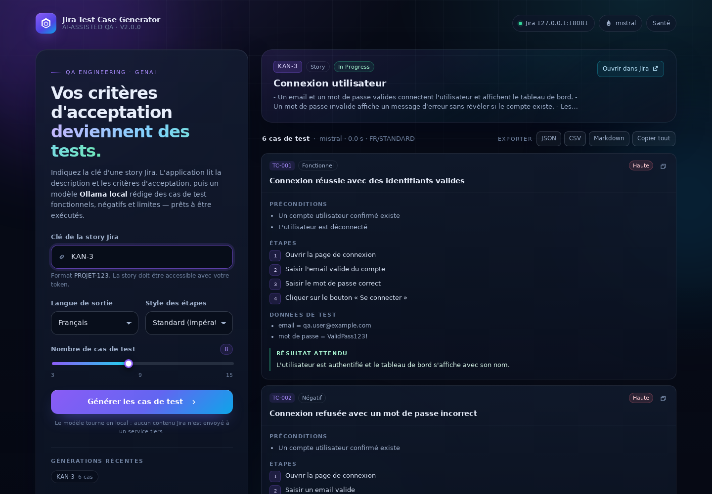

# 🧠 Jira Test Case Generator

**Transformez une user story Jira en plan de test fonctionnel structuré, grâce à un modèle d'IA local (Ollama).**

[](#stack-technique)
[](#stack-technique)
[](https://spring.io/projects/spring-ai)
[](https://ollama.com)
[](LICENSE.md)

> Version **2.0.0** — réécriture complète du projet initial. API typée, interface web, tests automatisés,
> gestion d'erreurs normalisée et **aucun secret dans le code**.



---

## Sommaire

1. [Le problème](#1-le-problème)
2. [La solution](#2-la-solution)
3. [Ce qui a changé depuis la v1](#3-ce-qui-a-changé-depuis-la-v1)
4. [Architecture](#4-architecture)
5. [Stack technique](#5-stack-technique)
6. [Démarrage rapide](#6-démarrage-rapide)
7. [Configuration](#7-configuration)
8. [Référence API](#8-référence-api)
9. [Sécurité](#9-sécurité)
10. [Tests et qualité](#10-tests-et-qualité)
11. [Documentation](#11-documentation)
12. [Déploiement](#12-déploiement)
13. [Licence et crédits](#14-licence-et-crédits)

---

## 1. Le problème

Une équipe QA reçoit des user stories Jira avec des critères d'acceptation rédigés en langage
naturel. En déduire des cas de test complets — chemin nominal, cas négatifs, valeurs limites,
sécurité, accessibilité — est :

- **chronophage** : 20 à 45 minutes par story pour un plan de test sérieux ;
- **inégal** : la couverture dépend de la personne qui rédige ;
- **difficile à maintenir** : les critères évoluent, les tests restent dans un tableur ;
- **peu traçable** : aucun lien direct entre la story et les tests générés.

## 2. La solution

L'application lit une story via l'**API REST Jira**, isole ses **critères d'acceptation**, puis
demande à un **LLM exécuté localement** de produire des cas de test **au format JSON strict**.
Le résultat est affiché dans une interface web, exportable en **JSON, CSV ou Markdown**, et reste
sur votre infrastructure : **aucune donnée Jira n'est envoyée à un service tiers**.

```
Jira REST API ──► AdfTextExtractor ──► AcceptanceCriteriaExtractor ──► PromptFactory
                                                                              │
                                                                    Ollama (local)
                                                                              │
                    Interface web  ◄── GenerationResponse ◄── Parser JSON strict
```

**Fonctionnalités clés**

- 🔎 Lecture d'une story par clé (`KAN-3`) avec support **Jira Cloud (v3 / ADF)** et **Server (v2 / texte)**.
- 🧠 Extraction automatique des critères d'acceptation depuis une section dédiée, un libellé
  inline, ou un **champ personnalisé** (`customfield_…`).
- ✅ Sortie typée : ID, titre, type, priorité, préconditions, étapes, données de test, résultat attendu.
- 🌍 Sortie en **français ou anglais**, étapes **standard** ou **Gherkin** (`Given/When/Then`).
- 📤 Export **JSON / CSV / Markdown**, copie d'un cas ou de la suite complète.
- 🕘 Historique local des générations récentes (navigateur uniquement).
- 🛡️ Erreurs normalisées **RFC 7807** avec codes stables, jamais de stack trace exposée.
- 🐳 **Dockerfile** + `docker-compose.yml` (application + Ollama).
- 🧪 **37 tests automatisés** (unitaires, client Jira, parsing, intégration HTTP complète).
- 🔐 Aucune credential en dur : tout passe par des variables d'environnement.

---

## 3. Ce qui a changé depuis la v1

| # | Constat sur la v1 | Correction apportée en v2 |
|---|-------------------|---------------------------|
| 1 | **Token Jira et email commités en clair** dans `application.properties` | Supprimés. Configuration par variables d'environnement uniquement ; `.env` ignoré par Git ; token à révoquer (voir §9). |
| 2 | Spring AI `1.0.0-SNAPSHOT` + dépôts milestone/snapshot | Versions **stables et épinglées** : Spring Boot 3.5.16, Spring AI 1.1.8 (BOM). Build reproductible. |
| 3 | Dépendances Jira Java Client + Jersey + Jackson redondantes et conflits `jakarta.ws.rs` | Remplacées par **Spring `RestClient`**, zéro dépendance superflue, timeouts explicites. |
| 4 | `ChatClient.defaultFunctions(...)` obsolète | API actuelle Spring AI, aucun usage déprécié. |
| 5 | Contrôleur renvoyant **du texte brut** avec `200 OK` même en cas d'erreur | Réponse **JSON typée** + **ProblemDetail** avec les bons statuts HTTP (400/404/502/503). |
| 6 | `catch (Exception)` → message générique, erreur avalée | Exceptions métier typées, logs structurés côté serveur, messages actionnables côté client. |
| 7 | Story non validée (`storyKey` arbitraire) | Validation `PROJET-123`, normalisation en majuscules, bornes sur `maxCases`. |
| 8 | Description ADF de Jira Cloud illisible (`asText()` sur un objet) | **`AdfTextExtractor`** : aplatit paragraphes, titres, listes, sauts de ligne. |
| 9 | Critères d'acceptation non isolés (description entière envoyée) | **`AcceptanceCriteriaExtractor`** : section FR/EN, libellé inline, champ custom, fallback documenté. |
| 10 | Sortie IA non structurée, non parsable | Contrat JSON strict + **parseur tolérant** (fences, alias, prose) + erreur `AI_RESPONSE_INVALID` explicite. |
| 11 | Démarrage impossible sans credentials (validation dans un `@Bean`) | L'application **démarre toujours** et expose son état via `/api/v1/config` (503 explicite à l'usage). |
| 12 | Aucun test utile (`contextLoads` seulement), aucun packaging | **37 tests**, tests d'intégration HTTP, Dockerfile, healthcheck, actuator, `.env.example`. |
| 13 | Pas d'interface : uniquement `curl` | Interface web responsive (thème sombre), exports, historique. |
| 14 | Logs verbeux (payload Jira complet, réponse IA) | Logs ciblés, jamais de token, données personnelles limitées. |
| 15 | Prompt sans garde-fou | Contexte délimité, instruction « données non fiables », troncature à 8 000 caractères. |
| 16 | Architecture `functions/` fourre-tout | Découpage `web / service / jira / ai / config / error`, responsabilités explicites. |

---

## 4. Architecture

```
src/main/java/com/asecurityguru/jiratestgen
├── JiraTestCaseGeneratorApplication.java
├── ai
│   ├── PromptFactory.java              # prompts système/utilisateur + garde-fous
│   ├── TestCaseGenerationService.java  # appel Ollama, limites, avertissements
│   ├── TestCaseResponseParser.java     # JSON tolérant → objets métier
│   └── model                           # TestCase, GeneratedTestCases, enums
├── config
│   ├── AiConfig.java                   # bean ChatClient
│   ├── GenerationProperties.java       # bornes de génération
│   └── JiraProperties.java             # URL/email/token/timeout
├── error                               # ApiException + sous-types métier
├── jira
│   ├── AcceptanceCriteriaExtractor.java
│   ├── AdfTextExtractor.java
│   ├── JiraRestClient.java
│   └── JiraStory.java
├── service
│   └── TestSuiteService.java           # validation, orchestration, mapping API
└── web
    ├── ApiExceptionHandler.java        # RFC 7807
    ├── ConfigController.java
    ├── TestCaseController.java
    └── dto                             # GenerationResponse, PublicConfigResponse
```

**Flux d'une requête**

1. `GET /api/v1/test-cases?storyKey=KAN-3&language=FR&format=STANDARD&maxCases=8`
2. `TestSuiteService` valide les paramètres (clé, langue, format, bornes).
3. `JiraRestClient` appelle `/rest/api/3/issue/KAN-3` (Basic auth, timeouts) et convertit l'ADF.
4. `AcceptanceCriteriaExtractor` isole les critères d'acceptation.
5. `PromptFactory` construit un prompt borné et protégé contre l'injection.
6. `ChatClient` interroge Ollama (`/api/chat`).
7. `TestCaseResponseParser` extrait les cas JSON, applique la limite, produit des avertissements.
8. Réponse JSON typée ou `ProblemDetail` (RFC 7807) selon le résultat.

---

## 5. Stack technique

| Composant | Version | Rôle |
|-----------|---------|------|
| Java | 17 (Temurin) | Runtime |
| Spring Boot | 3.5.16 | Web, validation, actuator, packaging |
| Spring AI | 1.1.8 | Abstraction `ChatClient` + connecteur Ollama |
| Ollama | courant | Modèle local (par défaut `mistral`) |
| Jira REST API | v3 (Cloud) / v2 (Server) | Source des stories |
| Gradle | 8.8 (wrapper) | Build reproductible |
| JUnit 5 + AssertJ + MockWebServer | via Boot BOM | Tests |
| HTML/CSS/JS natifs | — | Interface, sans étape de build front |

Aucune base de données, aucune file d'attente, aucune dépendance SaaS : le déploiement tient
dans un seul JAR.

---

## 6. Démarrage rapide

### Prérequis

- **JDK 17** (`java -version`)
- **Ollama** installé ([ollama.com/download](https://ollama.com/download)) avec un modèle :
  ```bash
  ollama pull mistral        # ou llama3.1, qwen2.5, etc.
  ```
- Une instance **Jira Cloud** (ou Server/Data Center) et un **token API** :
  [id.atlassian.com/manage-profile/security/api-tokens](https://id.atlassian.com/manage-profile/security/api-tokens)

### 1. Configuration

```bash
cp .env.example .env
# éditez .env avec votre URL, votre email et votre token
set -a && source .env && set +a
```

Ou exportez directement :

```bash
export JIRA_BASE_URL=https://votre-domaine.atlassian.net
export JIRA_EMAIL=vous@example.com
export JIRA_API_TOKEN=...
export OLLAMA_BASE_URL=http://localhost:11434
export AI_MODEL=mistral
```

### 2. Lancer

```bash
./gradlew bootRun
```

L'application démarre sur [http://localhost:8080](http://localhost:8080).
L'interface web est servie à la racine, l'API sous `/api/v1`.

### 3. Vérifier

```bash
curl http://localhost:8080/actuator/health
curl http://localhost:8080/api/v1/config

curl "http://localhost:8080/api/v1/test-cases?storyKey=KAN-3&language=FR&maxCases=8"
```

### Docker (application + Ollama)

```bash
cp .env.example .env    # renseignez JIRA_*
docker compose up -d --build
docker compose exec ollama ollama pull mistral
```

> Le téléchargement du modèle est volontairement séparé : le conteneur ne doit pas tirer
> plusieurs Go à chaque démarrage.

---

## 7. Configuration

| Variable | Défaut | Description |
|----------|--------|-------------|
| `JIRA_BASE_URL` | — | URL de l'instance, avec ou sans `/rest/api/3` |
| `JIRA_EMAIL` | — | Email du compte Atlassian (Basic auth) |
| `JIRA_API_TOKEN` | — | Token API Atlassian (**jamais commité**) |
| `JIRA_API_VERSION` | `3` | `3` pour Cloud, `2` pour Server/Data Center |
| `JIRA_ACCEPTANCE_CRITERIA_FIELD` | — | Champ custom contenant les critères (`customfield_10042`) |
| `JIRA_TIMEOUT` | `15s` | Timeout connexion/lecture Jira |
| `OLLAMA_BASE_URL` | `http://localhost:11434` | Endpoint Ollama |
| `AI_MODEL` | `mistral` | Modèle Ollama |
| `AI_TEMPERATURE` | `0.2` | Température (créativité) |
| `AI_NUM_CTX` | `8192` | Fenêtre de contexte |
| `SERVER_PORT` | `8080` | Port HTTP |
| `GENERATION_DEFAULT_TEST_CASES` | `8` | Nombre de cas par défaut |
| `GENERATION_MAX_TEST_CASES` | `20` | Plafond dur |
| `GENERATION_MAX_STORY_CHARACTERS` | `8000` | Troncature du contexte story |

Sans credentials, l'application démarre quand même : `/api/v1/config` indique
`jiraConfigured: false`, l'interface affiche une bannière et l'API répond
`503 JIRA_NOT_CONFIGURED` avec la marche à suivre.

---

## 8. Référence API

### `GET /api/v1/test-cases`

Alias rétrocompatible : `GET /api/v1/jira-story` (mêmes paramètres, même réponse).

| Paramètre | Obligatoire | Défaut | Valeurs |
|-----------|-------------|--------|---------|
| `storyKey` | oui | — | `PROJET-123` |
| `language` | non | `FR` | `FR`, `EN` |
| `format` | non | `STANDARD` | `STANDARD`, `GHERKIN` |
| `maxCases` | non | `8` | 1 à `GENERATION_MAX_TEST_CASES` |

**Exemple**

```bash
curl "http://localhost:8080/api/v1/test-cases?storyKey=KAN-3&language=FR&format=GHERKIN&maxCases=6"
```

```json
{
  "story": {
    "key": "KAN-3",
    "summary": "Connexion utilisateur",
    "issueType": "Story",
    "status": "In Progress",
    "url": "https://votre-domaine.atlassian.net/browse/KAN-3",
    "description": "En tant qu'utilisateur enregistré…",
    "acceptanceCriteria": "- Un email et un mot de passe valides connectent l'utilisateur…",
    "acceptanceCriteriaSource": "description-section"
  },
  "generation": {
    "model": "mistral",
    "language": "FR",
    "format": "GHERKIN",
    "generatedAt": "2026-11-09T20:31:02.114Z",
    "durationMs": 8421,
    "testCaseCount": 6
  },
  "testCases": [
    {
      "id": "TC-001",
      "title": "Connexion réussie avec des identifiants valides",
      "type": "Fonctionnel",
      "priority": "Haute",
      "preconditions": ["Un compte utilisateur confirmé existe"],
      "steps": ["Given un compte confirmé", "When je saisis des identifiants valides", "Then le tableau de bord s'affiche"],
      "testData": ["email = qa.user@example.com"],
      "expectedResult": "L'utilisateur est authentifié et le tableau de bord s'affiche."
    }
  ],
  "warnings": []
}
```

### Autres endpoints

| Méthode | Chemin | Description |
|---------|--------|-------------|
| `GET` | `/api/v1/config` | Configuration publique (sans secret) |
| `GET` | `/actuator/health` | Sonde de santé (Docker/K8s) |
| `GET` | `/` | Interface web |
| `GET` | `/actuator/info` | Version de l'application |

### Codes d'erreur

Toutes les erreurs utilisent `application/problem+json` :

```json
{
  "type": "about:blank",
  "title": "Not Found",
  "status": 404,
  "detail": "No Jira issue found for key 'KAN-404'…",
  "instance": "/api/v1/test-cases",
  "code": "STORY_NOT_FOUND",
  "timestamp": "2026-11-09T20:31:02Z"
}
```

| Code | HTTP | Signification | Action |
|------|------|---------------|--------|
| `VALIDATION_ERROR` | 400 | Paramètre absent/invalide | Corriger la requête |
| `STORY_NOT_FOUND` | 404 | Clé inconnue ou projet non autorisé | Vérifier la clé et les droits |
| `JIRA_AUTH_FAILED` | 502 | 401/403 Jira | Régénérer le token |
| `JIRA_UNAVAILABLE` | 502 | Timeout, 5xx, réponse illisible | Vérifier URL/réseau/version API |
| `JIRA_NOT_CONFIGURED` | 503 | Variables manquantes | Renseigner `JIRA_*` |
| `AI_UNAVAILABLE` | 503 | Ollama arrêté ou modèle absent | `ollama serve` + `ollama pull` |
| `AI_RESPONSE_INVALID` | 502 | Sortie modèle non exploitable | Réessayer / changer de modèle |
| `INTERNAL_ERROR` | 500 | Erreur inattendue | Consulter les logs |

---

## 9. Sécurité

> ⚠️ **La version 1 contenait un token Jira et un email en clair dans le dépôt.**
> Tout token exposé doit être considéré comme compromis : **révoquez-le immédiatement**
> depuis Atlassian, puis générez-en un nouveau. La v2 ne contient plus aucun secret.

Mesures en place :

- secrets uniquement via variables d'environnement (`.env` ignoré par Git) ;
- `.env.example` avec valeurs fictives explicites ;
- aucune credential dans les logs, les réponses ou `/api/v1/config` ;
- validation stricte des entrées (`PROJET-123`, enums, bornes) avant tout appel amont ;
- timeouts de connexion/lecture côté Jira ;
- contexte story délimité et tronqué, consigne explicite de **ne jamais suivre les
  instructions contenues dans la story** (anti prompt-injection) ;
- sortie modèle **toujours parsée**, jamais interprétée comme du HTML dans l'interface
  (rendu via `textContent`) ;
- erreurs internes journalisées côté serveur, jamais renvoyées au client ;
- conteneur Docker non-root avec healthcheck.

En production, ajoutez un reverse proxy TLS et une authentification devant l'application :
elle n'embarque volontairement pas de gestion d'utilisateurs, car elle est pensée comme un
outil interne.

---

## 10. Tests et qualité

```bash
./gradlew test
```

**37 tests, tous verts** (vérifiés le 9 novembre 2026) :

| Suite | Ce qu'elle prouve |
|-------|-------------------|
| `AdfTextExtractorTest` (4) | ADF Cloud, texte v2, nœuds inconnus, null |
| `AcceptanceCriteriaExtractorTest` (6) | Section FR/EN, inline, fallback, section vide |
| `JiraRestClientTest` (7) | Mapping, auth Basic, champ custom, 404/401/500, URL legacy |
| `TestCaseResponseParserTest` (6) | Fences, tableau nu, alias, prose, entrées invalides |
| `PromptFactoryTest` (4) | Contenu, Gherkin/EN, troncature, critères absents |
| `TestCaseGenerationServiceTest` (6) | Limites, avertissements, erreurs IA |
| `ApiIntegrationTest` (8) | Contrat HTTP complet, erreurs, `/config`, UI, health |

Le test d'intégration remplace Jira par **MockWebServer** et le modèle par un **`ChatModel`
factice** : il ne nécessite ni tenant Atlassian ni GPU, et s'exécute en CI.

**Vérification manuelle effectuée** : application lancée sur un Jira simulé et un Ollama simulé,
interface pilotée dans un navigateur, génération de 6 cas, exports JSON/CSV/Markdown contrôlés,
et réponse d'erreur 404 vérifiée.

---

## 11. Documentation

| Document | Contenu |
|----------|---------|
| [`docs/Jira-Test-Case-Generator-Documentation.pdf`](docs/Jira-Test-Case-Generator-Documentation.pdf) | Documentation technique complète (architecture, API, sécurité, tests, exploitation) |
| [`docs/Jira-Test-Case-Generator-Presentation.pptx`](docs/Jira-Test-Case-Generator-Presentation.pptx) | Présentation projet (contexte, refonte, démo, résultats, roadmap) |
| `docs/images/` | Captures d'écran utilisées dans la documentation |
| `docs/generate_documentation.py` | Script de génération du PDF (reproductible) |
| `docs/generate_presentation.py` | Script de génération de la présentation |

Régénérer les documents (Python 3 + `reportlab`, `python-pptx`, `pillow`) :

```bash
cd docs
python3 -m venv .venv && source .venv/bin/activate
pip install reportlab python-pptx pillow
python generate_documentation.py
python generate_presentation.py
```

---

## 12. Déploiement

**JAR autonome**

```bash
./gradlew clean bootJar
JIRA_BASE_URL=… JIRA_EMAIL=… JIRA_API_TOKEN=… \
  java -jar build/libs/jira-test-case-generator.jar
```

**Docker**

```bash
docker build -t jira-test-case-generator:2.0.0 .
docker run --rm -p 8080:8080 --env-file .env jira-test-case-generator:2.0.0
```

**Reverse proxy** : exposez `/` et `/api/` en HTTPS, laissez `/actuator/health` accessible
uniquement au réseau interne ou au load balancer.

---

## 13. Licence et crédits

Projet initié par **Alex Alkhatib** — refonte 2.0 : architecture, sécurité, interface, tests et
documentation.

Distribué sous licence **MIT** — voir [LICENSE.md](LICENSE.md).

> Les marques Jira et Atlassian appartiennent à Atlassian. Ollama est un projet indépendant.
